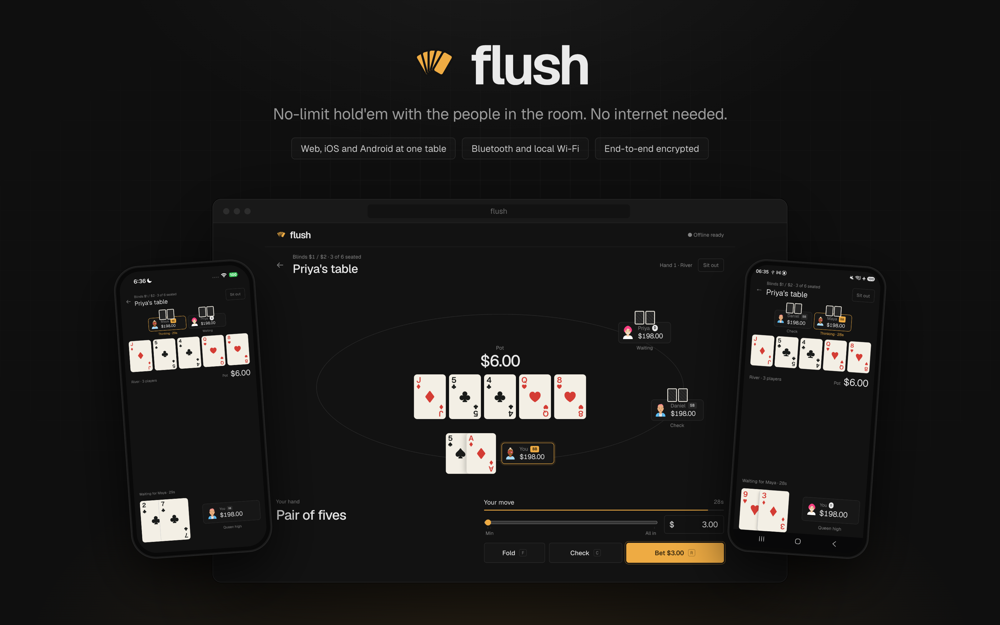

# flush



No-limit Texas hold'em for the people in the room. It plays over Bluetooth and the local network, with no internet and no server. It runs in Chrome, on Android and on iOS, all built on the [Offline Protocol SDK](https://github.com/Offline-Protocol/offline-protocol-sdk).

## How a table connects

One device hosts. It shuffles and deals, runs the rules and the turn clock, and sends each player their own view of the table, with their hole cards and nobody else's, as an end-to-end encrypted direct message. Players send their actions back to the host. The host is trusted: it could see everyone's cards.

| At the table | Host | How the others connect |
|---|---|---|
| At least one phone | A phone | Other phones find the table themselves (Bluetooth LE, Wi-Fi Direct, LAN). Browsers tap **Join → Connect to a phone** and pick the host in Chrome's Bluetooth list. Browsers reach each other through the phone, and the phone can't read their messages. |
| Browsers only | A browser | Same Wi-Fi network. The host taps **+ Browser** and shows a QR code. The joiner scans it (or pastes it) and shows a code back. |

Joining a phone's table from a browser needs Web Bluetooth, which only Chromium has (Chrome on a computer or Android). Safari, Firefox and every iOS browser need the app instead.

## Layout

```
engine/   rules, hand evaluator, side pots, table protocol (Host/Guest), display helpers, avatars
web/      Vite + React app over the SDK's browser binding (bindings/web)
mobile/   bare React Native app over @offline-protocol/mesh-sdk
```

`engine/` is plain TypeScript with no dependencies. Both apps import it directly.

## Run it

**Engine tests:** `node --test engine/*.test.ts` (Node 24). This covers hand ranking, blinds, the big blind's option, incomplete all-in raises, side pots, 2,000 hands of random play checking that chips are conserved, and a host and two guests playing over an in-memory network.

**Web.** The browser binding isn't on npm yet. `web/scripts/sync-sdk.sh` copies it from a checkout of the SDK beside this repo (`../offline-protocol-sdk`, or set `SDK_DIR`). Build the binding there first with `bash bindings/web/scripts/build.sh`.

```bash
cd web && npm install
npm run dev        # http://localhost:5173 (?profile=b runs a second player in another tab)
npm run build      # dist/, with a service worker that precaches the app and the SDK
```

Web Bluetooth, WebRTC and the SDK's storage need a secure context, so serve `dist/` over HTTPS (localhost also works). After one visit with internet, the page loads and plays with none.

**Phones.** These use `@offline-protocol/mesh-sdk` 0.31.0 from npm.

```bash
cd mobile && npm install
cd ios && pod install && cd ..
npx react-native run-ios --device --mode Release     # set your team in Xcode first
npx react-native run-android --mode release
```

`ios/Podfile` patches two React Native 0.82 build problems under Xcode 26 (fmt's `consteval`, and pods declaring iOS 13). The app keeps the screen on, because the host phone carries the table.

## Game rules

- **Format:** cash game, 2 to 6 seats. The host picks the blinds ($0.10/$0.20 up to $2/$5) and a buy-in of 50, 100 or 200 big blinds.
- **Turn clock:** 30 seconds. A player who runs out of time checks if they can, otherwise folds, and is sat out until they tap **I'm back**. A player who has disconnected gets 10 seconds.
- **Joining and busting:** players who join mid-hand are dealt in on the next one. A busted player can rebuy.
- **Rules followed:** heads-up the button posts the small blind and acts first preflop. An all-in short of a full raise doesn't reopen the betting for players who have already acted. Uncalled bets go back. Side pots are split by contribution, and odd chips go to the first winner left of the button.

## Not built

- **Host hand-off:** if the host leaves, the table ends.
- **Hand history, chat, sound.**
- **Reconnecting a browser after a WebRTC drop:** it needs two fresh codes, as the SDK requires.
- **Mental poker (a shuffle the host can't see):** the host is trusted.

## Licensing

The code in this repository is licensed under [MIT-0](./LICENSE) (MIT No
Attribution): copy it into your own project without keeping a notice. The fonts,
the DiceBear patch and the React Native template files keep their own licenses;
see [THIRD_PARTY_NOTICES.md](./THIRD_PARTY_NOTICES.md).

That license covers only this repository's code. The apps depend on
`@offline-protocol/mesh-sdk` and the SDK's browser binding, which are licensed
under **AGPL-3.0-only** or a **commercial license** from Offline Protocol, Inc.
An app that embeds the SDK, including one built from this repository, is
subject to the AGPL-3.0-only unless you hold a commercial license. See
[Licensing](https://www.offlineprotocol.com/docs/operations/licensing) and
[pricing](https://www.offlineprotocol.com/pricing), or contact
legal@offlineprotocol.com.
